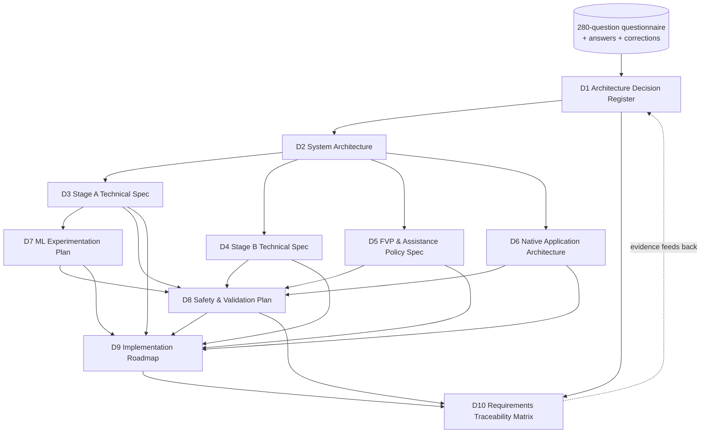

<!-- Part of the MaxSight V1 Technical Architecture Specification. See 00-overview.md. Source: approved plan 2026-10-31. -->

# MaxSight V1: Technical Architecture and Implementation Specification

**Document set:** D1–D10, plus an executive overview, a master diagram and a self-audit.
**Source of truth:** the 280-question Architecture Decision Questionnaire, your answers, your later corrections, and the upgrade directive of 2026-10-31.
**Repository baseline:** `AstroSword2897/MaxSight`, `main` @ `905c994`, audited 2026-10-30/31.

**After approval:**
- The ten deliverables are committed as separate files under `docs/architecture/v1/` (`01-decision-register.md` … `10-traceability-matrix.md`).
- ADRs go to `docs/adr/`.
- Then Phase 1 of D9 starts.

**Notation used throughout:**

| Tag | Meaning |
|---|---|
| **Confirmed** | You decided it (questionnaire answer, correction or directive) |
| **Proposed** | An engineering solution proposed here; not yet approved by you |
| **Open** | Needs your decision |
| **Experiment** | Decided by an experiment defined in D7/D8 |
| **Blocked** | Depends on an external party or resource |
| `[E]` | Exists in the repo today (file:line given) |
| `[P]` | Planned (does not exist yet) |
| *(exp.)* | An experimental numeric value: never a release threshold until approved under DR-205 |

---

## Executive overview

MaxSight V1 is an **iOS-first** assistive environmental-awareness system for **people with low vision**, used indoors and outdoors (DR-001…004). It has three conceptual layers (DR-008):

1. **Environmental perception:** what is there, where, how it moves, how reliable it is.
2. **Functional Vision Profile (FVP):** the user's needs and preferences.
3. **Assistance policy:** whether, what and how to communicate.

These run in two execution stages:

- **Stage A (on the iPhone, offline-capable)** is the seven-component perception and safety pipeline (DR-010):
  1. frame quality
  2. SSD-MobileNet detection
  3. temporal tracking
  4. spatial estimation
  5. uncertainty assessment
  6. hazard assessment
  7. local safety and alert controller

  Its urgent alerts never wait for anything else (DR-005).
- **Stage B (cloud, required for the complete V1)** handles on-demand understanding: OCR interpretation, object finding, scene understanding, contextual Q&A, knowledge retrieval (DR-006). It can never override or delay Stage A (DR-015). **Which visual data Stage B may receive is the most consequential open decision (DR-201).** The V1 Stage B *product scope* is defined by the capability matrix in D4.0:
- Only capabilities that work **without image egress** (on-device-derived text or structured metadata) are committed to V1.
- Capabilities needing pixels are listed as "requires authorised image transmission" and are **not advertised** unless DR-201 approves them.

**V1 inputs are the camera (perception) and the microphone (spoken requests) only**; no IMU, LiDAR or other sensor (DR-017).

**Current state (verified):**
- The repo has reusable foundations `[E]`:
  - Stage A types and model-handle resolution
  - Ed25519 artifact signature verification (instance contract `artifact_signature.json`, policy `configs/security/artifact_signing.yaml`; replaced HMAC on 2026-11-07, see `docs/architecture/MAXSIGHT_ARCHITECTURE.md` §12.3)
  - connectivity monitor
  - Stage B client with timeout
  - OTA staging and rollback
  - haptic backends
  - output scheduler
  - safety-gate manifest code
  - productization docs
  - web simulator
- It has **no trained model**: all 14 `checkpoints/*` folders are empty.
- It has **no hazard labels**: `datasets/` is synthetic with heuristic urgency.
- There is **no real TTS** and **no iOS app**.
- **CI is red on main** (D9 task P1-01…P1-06).

---

## Master diagram: how the ten deliverables connect

# Self-audit (after the technical correction pass)

**Accepted external review of the previous revision:** architecture 8.4, implementation 7.6, overall 8.0. Its seven issues are addressed in this pass:

| # | Issue | Correction | Where |
|---|---|---|---|
| 1 | Sensor boundary | IMU and LiDAR closed and excluded; camera + microphone only; ground truth from tape marks | DR-017, DR-210/211, D6.1, D7.4, D7.8 |
| 2 | Spatial over-confidence | Calibration routine and validity conditions; camera-only validity monitor; flow failure detection; looming indicator separated from physical speed; τ cannot trigger critical alone (R1/R1b); error reported per category × bucket × environment | D3.6.1–3.6.4, D3.4 |
| 3 | Latency budget | End-to-end boundaries L0–L7a; allocation vs measurement; component p95s not summed; 80 ms left unresolved | D3.1b, D8.3, DR-204 |
| 4 | Stage B scope vs privacy | Capability matrix (4 categories); only no-image capabilities committed; advertising rule | D4.0, executive overview |
| 5 | ML chain and identifiers | Dependency chain with gates; ID reconciliation; curb/stair coverage warning | D7.0 |
| 6 | Premature parameters | Parameter registry PR-001…025 with status and approver; release refuses non-approved safety parameters | D1.4 |
| 7 | Feasibility gates | Evidence-based phase exits + contingencies; schedule labelled as an estimate | D9.0 |

**Current honest assessment:** the document's own judgement replaces the earlier self-scores, which are withdrawn.
- No re-score is claimed. The external review's criterion ("an engineer can implement without guessing; algorithms survive device testing") cannot be confirmed on paper.
- The remaining gaps that block 9/10 are now **evidence**, not specification:
  1. DR-201/202/206 decisions (P1-08)
  2. the first device measurements of L2/L5/L7 and thermal (P4-04, P6-06)
  3. the ground-plane valid-rate and error on walking clips (P6-03)
  4. a Bedrock model choice to turn token budgets into dollars (DR-213)
  5. reviewer availability (DR-209)

# Self-audit history (previous revision, superseded)

### Architecture quality: **8.8 / 10**

**Evidence for the score:**
- Consistent component IDs (C-01…C-30) across all diagrams.
- Seven-component Stage A matching your diagram order.
- Explicit invariants with tests (INV-1…8).
- A full egress matrix with dependency statements.
- Every decision traced to a questionnaire source.
- Stage B bounded by contract.
- Platform-agnostic core with golden-vector parity.

**Remaining deficiencies:**
1. DR-201 (egress) is unresolved, so Stage B's visual scope is necessarily conditional.
2. DR-210 (IMU) is unresolved. The camera-only fixed-pitch assumption weakens path relevance while walking.
3. The taxonomy (DR-202) and device matrix (DR-206) are defaults, not decisions.

**Corrective actions:** decide DR-201/202/206/210 in P1-08. Each decision raises the score because it removes a conditional branch from D3/D4.

### Implementation readiness: **8.5 / 10**

**Evidence for the score:**
- Every component has I/O schemas with types, units, ranges and null semantics.
- 50+ tasks with dependencies, steps, acceptance, tests and evidence.
- A critical path.
- Exact model variants and training hyperparameters.
- Existing code reuse identified by file:line.
- Gate computation defined.

**Remaining deficiencies:**
1. Numeric thresholds are pending (by design; DR-205), so "done" for SG cells cannot yet be evaluated.
2. Stage B per-task costs are given as token budgets, not dollars (model unchosen; DR-213).
3. Human-factors tasks are blocked externally (DR-209).
4. The Android plan is architectural only (DR-215).

**Corrective actions:**
- Choose the Bedrock model (DR-213) and compute $/task.
- Run P3-05 on the dev set to propose thresholds.
- Line up reviewers (DR-209).

**Why not 9 yet:** both scores reach ≥ 9 once P1-08's four decisions are recorded. No document change can substitute for those decisions.
