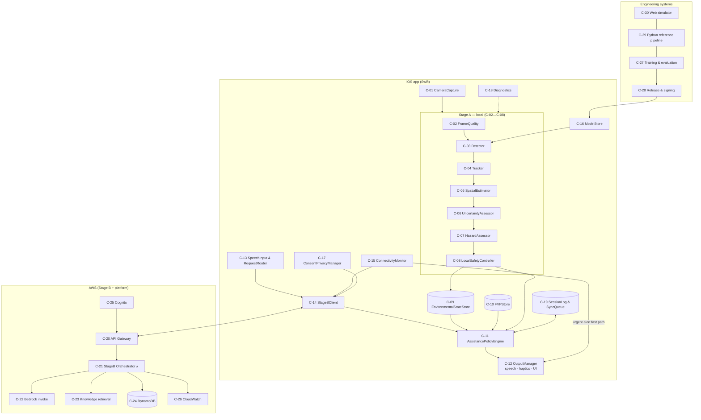
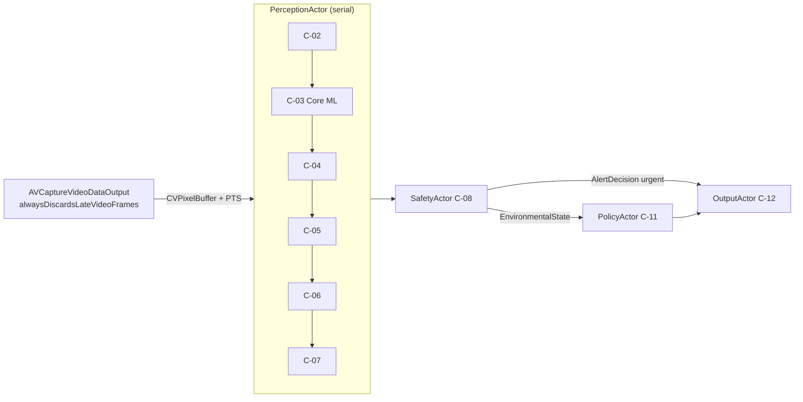
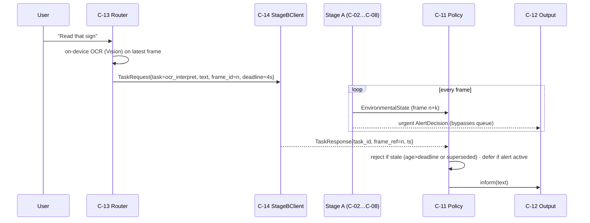

<!-- Part of the MaxSight V1 Technical Architecture Specification. See 00-overview.md. Source: approved plan 2026-10-31. -->

# D2: System Architecture Specification

### D2.1 System context

```mermaid
flowchart LR
  U((Low-vision user)) -- speech/button requests --> APP
  APP -- speech · haptics · accessible UI --> U
  ENV[(Physical environment)] -- light --> CAM[iPhone camera]
  CAM --> APP[MaxSight iOS app\nStage A + FVP + Policy + Output]
  MIC[iPhone microphone] --> APP
  APP <-- HTTPS (Cognito JWT) --> CLOUD[MaxSight cloud\nStage B API]
  CLOUD --> BR[Amazon Bedrock\n(approved model)]
  CLOUD --> KB[(Approved knowledge sources)]
  REL[(Model release store\nS3 + KMS signatures)] -- signed model package\n(app bundle / staged update) --> APP
  DEV[Engineering: training & evaluation\nPython · SageMaker · CI] --> REL
```

**External actors:**
- the user
- the environment
- AWS-managed services (Bedrock, Cognito)
- independent reviewers (thresholds, pilot)
- Apple platform services (App Store, on-device speech and vision frameworks)

### D2.2 Component architecture



### D2.3 Component catalogue

Status: `[E]` exists in repo (path), `[P]` planned.

| ID | Component | Responsibility | Inputs → Outputs | Depends on | Runs on | Runtime | Failure behaviour | Security/privacy | Tests | Status |
|---|---|---|---|---|---|---|---|---|---|---|
| C-01 | CameraCapture | Deliver timestamped frames, latest-only | camera → `FrameMetadata`+pixel buffer | AVFoundation | iOS | 30 fps capture | permission lost/interrupted → `UNAVAILABLE` | frames never persisted | XCTest + UI tests | [P] |
| C-02 | FrameQuality | Judge frame usability | frame → `FrameQualityResult` | — | iOS (+Py ref) | every processed frame, ≤2 ms | — (pure) | none | unit | [P] |
| C-03 | Detector | Objects + boxes + scores | frame → `DetectionBatch` | C-16 model | iOS Core ML | ≤50 ms *(exp.)* | model error → `UNAVAILABLE` (via C-08) | on-device | unit, parity | [P] (Py ref partial `[E] ml/runtime/stage_a/torch_runner.py` to be replaced) |
| C-04 | Tracker | Associate detections over time | `DetectionBatch` → `TrackedObject[]` | — | iOS | ≤2 ms | reset on discontinuity | RAM only | unit | [P] |
| C-05 | SpatialEstimator | Direction, ground-plane distance, relative motion | tracks + camera model → `SpatialEstimate` | camera calibration | iOS | ≤1 ms | invalid → nulls + reasons | none | unit | [P] |
| C-06 | UncertaintyAssessor | Per-source uncertainty + evidence reliability | all above → `UncertaintyAssessment` | calibration params | iOS | ≤1 ms | — | none | unit | [P] |
| C-07 | HazardAssessor | Category, path relevance, urgency, hazard events | tracks+spatial+uncertainty → `HazardAssessment[]`, `HazardEvent[]` | rules YAML | iOS | ≤2 ms | rules missing → `UNAVAILABLE` | none | unit + rule trace | [P] |
| C-08 | LocalSafetyController | Alert decisions for hazards; dedup; escalation; degraded states; fast path to output | events + state → `AlertDecision`, `EnvironmentalState` | C-12 | iOS | ≤1 ms | never silent | none | unit + invariants | [P] |
| C-09 | EnvironmentalStateStore | Latest consistent state for policy | `EnvironmentalState` | — | iOS | per frame | stale > 300 ms → INSUFFICIENT_EVIDENCE | RAM | unit | [P] |
| C-10 | FVPStore | Profile CRUD, versioning, consent | user edits → `FVP` | Keychain/file protection | iOS | on change | corrupt → defaults + notice | protected file | unit | [P] (Py `[E] app/personal_mode.py` is unrelated ML personalisation) |
| C-11 | AssistancePolicyEngine | 7 actions, priority, interruption | state + FVP + Stage B results → `AssistanceAction[]` | C-09, C-10 | iOS | per state update + per Stage B response | — | none | unit + property tests | [P] |
| C-12 | OutputManager | Speech, haptics, UI announcements, channel fallback | actions → device output | AVSpeech, CoreHaptics, UIAccessibility | iOS | event-driven | channel failure → alternate channel + DEGRADED | none | unit + device | [P] (Py `[E] app/ui/haptic_backends.py`, `ml/utils/output_scheduler.py:74` as reference) |
| C-13 | SpeechInput & RequestRouter | On-device ASR; map utterance → Stage B task or local action | microphone → `TaskRequest` | Speech framework (on-device) | iOS | on demand | ASR unavailable → button UI | audio not stored | unit + UI | [P] |
| C-14 | StageBClient | Signed requests, 4 s deadline, cancel, stale rejection | `TaskRequest` → `TaskResponse` | C-15, C-17, C-25 | iOS | on demand | timeout/offline → explicit message | TLS, JWT, egress policy | unit + integration | [P] (Py `[E] app/stage_b/client.py`, `messages.py:3-5` reference) |
| C-15 | ConnectivityMonitor | ONLINE_FULL / DEGRADED / OFFLINE with debounce | NWPathMonitor + health → state | Network framework | iOS | event | — | none | unit | [P] (Py `[E] app/connectivity/monitor.py:10-60`) |
| C-16 | ModelStore | Resolve ACTIVE → LKG → REFUSED; verify signature/hash; staging; rollback | packages → `ModelHandle` | CryptoKit | iOS | startup + update | both invalid → `UNAVAILABLE` | signature verify | unit + integrity | [P] (Py `[E] ml/runtime/stage_a/model_handle.py:67`, `app/model_update/*`) |
| C-17 | ConsentPrivacyManager | Consent records; egress allow-list; deletion requests | user choices → policy | C-10 | iOS | on change | default deny | central gate for egress | unit | [P] |
| C-18 | Diagnostics | Latency/metrics; local logs; optional upload | events → metrics | C-17 | iOS | continuous | — | no frames, no PII | unit | [P] |
| C-19 | SessionLog & SyncQueue | Append-only events; idempotent sync | events → queue | C-24 | iOS + cloud | async | offline → queue | encrypted at rest | unit + integration | [P] |
| C-20 | API Gateway | HTTPS entry, JWT authoriser, throttling | requests | C-25 | AWS | on demand | 429/503 | TLS 1.2+ | integration | [P] |
| C-21 | StageB Orchestrator (Lambda) | Validate, quota, route task, deadline, structured response | `TaskRequest` → `TaskResponse` | C-22/23/24 | AWS | ≤3.5 s budget | timeout → `status=timeout` | IAM scoped | unit + integration | [P] |
| C-22 | Bedrock invoke | Language reasoning over permitted inputs | prompt → text/JSON | Bedrock | AWS | ≤3 s | throttle → error | model-ARN-scoped IAM | eval set | [P] |
| C-23 | Knowledge retrieval | Retrieve approved passages with citations | query → passages | approved corpus | AWS | ≤500 ms | none found → "no source" | corpus licence | eval set | [P] (`[E] ml/retrieval/*` is research, not this) |
| C-24 | DynamoDB | Quotas, preferences sync, idempotency keys | items | — | AWS | — | — | SSE, least privilege | integration | [P] |
| C-25 | Cognito | Short-lived tokens | sign-in → JWT | — | AWS | — | — | no embedded creds | integration | [P] |
| C-26 | CloudWatch | Logs/metrics/alarms | events | — | AWS | — | — | no PII | ops tests | [P] |
| C-27 | Training & evaluation | Datasets, training, eval, benchmark, selection | data → checkpoints, reports | SageMaker, local | Mac/AWS | batch | — | licence tags | pytest + gates | partial `[E] ml/training/*`, `scripts/ops/sagemaker_train.py` |
| C-28 | Release & signing | Certify → manifest → sign → publish | artifacts → packages | KMS, S3, CI | CI/AWS | per release | any gate fail → no package | signing key isolation | `gate_release` | partial `[E] ml/infra/artifact_signing.py`: Ed25519 instance contract + YAML policy shipped 2026-11-07; key custody (file key in secret store vs KMS) open |
| C-29 | Python reference pipeline | Same 7 components in Python for eval + golden vectors | clips → `HazardResult` JSONL | C-27 | Mac | dev | — | dev data only | pytest | [P] |
| C-30 | Web simulator | Visual debugging of reference pipeline | uploads → overlays | C-29 | Mac/local | dev | — | local only | Playwright | `[E] tools/simulation/web_simulator.py` |

### D2.4 Stage A local architecture

D3 has the full detail. Execution model on iOS:



- **Latest-frame-only:** a frame arriving while PerceptionActor is busy replaces the pending one, and the drop is counted.
- **Urgent fast path:** C-08 → C-12 for urgency ≥ 2 bypasses C-11 queueing (C-11 is informed afterwards, for deduplication).

### D2.5 Stage B cloud architecture

```mermaid
flowchart LR
  APP[C-14 StageBClient] -->|POST /v1/tasks\nJWT · Idempotency-Key| GW[C-20 API Gateway\nthrottle 2 rps/user]
  GW --> L[C-21 Orchestrator λ\nvalidate schema → check quota (C-24)\n→ route by task_type → deadline 3.5 s]
  L -->|scene / VQA / OCR-interpret| BR[C-22 Bedrock]
  L -->|retrieve| KR[C-23 Knowledge retrieval]
  L -->|quota, idempotency| DDB[(C-24)]
  L --> CW[C-26 logs + EMF metrics]
  L -->|TaskResponse| APP
```

### D2.6 Local/cloud coordination



**Coordination rules:**
1. Stage A never awaits Stage B.
2. A Stage B response is rejected if `now − request_ts > deadline` or a newer request of the same task type exists.
3. A response is deferred while any alert ≥ HIGH is being delivered.
4. A response can never modify `HazardAssessment`/`EnvironmentalState` (DR-015).

### D2.7 FVP architecture

```mermaid
flowchart LR
  ONB[Onboarding (spoken)] --> FVP[(C-10 FVPStore\nversioned JSON, file protection)]
  SET[Settings UI] --> FVP
  FVP -->|read-only| POL[C-11 Policy]
  FVP -->|read-only| OUT[C-12 Output]
  FVP -. consent-gated sync .-> DDB[(C-24 prefs)]
  STAGEA[Stage A] -. "no import (enforced)" .- FVP
```

### D2.8 Assistance-policy architecture

D5.3 has the full rules.

```mermaid
flowchart LR
  ES[EnvironmentalState] --> PRI[Safety tier\nurgency ≥2 → alert]
  ES --> INF[Context tier\nurgency ≤1 → inform/stay_quiet]
  SB[Stage B TaskResponse] --> REQ[Request tier\nanswer/refuse/defer]
  FVP --> FMT[Formatting\nverbosity · modality · rate]
  PRI & INF & REQ --> ARB[Arbiter: safety > request > context\ndedup · cap (non-critical only)] --> FMT --> OUT[OutputManager]
```

### D2.9 Privacy and data flow

D4.6 has the egress matrix.

```mermaid
flowchart LR
  subgraph PHONE["iPhone (local)"]
    F[Frames (RAM)] --> SA[Stage A]
    F --> OCR[On-device OCR]
    SA --> META[Structured detections/hazards]
    MIC[Audio (RAM)] --> ASR[On-device ASR] --> TXT[Request text]
    FVP[(FVP)] ; LOG[(Session log)]
  end
  META -->|allow-list fields only, if DR-201 permits| API
  OCR -->|derived text, consent class C2| API
  TXT -->|request text| API
  F -.->|BLOCKED unless DR-201 approves image egress| API[Stage B API]
  FVP -.->|consent-gated sync| DDB[(Prefs)]
```

### D2.10 Failure and degraded operation

| Failure | Detected by | System response | User signal | Stage A affected? |
|---|---|---|---|---|
| Camera permission lost or camera interrupted | C-01 | stop perception; `UNAVAILABLE` | "Camera unavailable. Hazard detection is off." | Off (announced) |
| Model ACTIVE invalid | C-16 | load LKG | none (log) | No |
| Model ACTIVE and LKG invalid | C-16 | `UNAVAILABLE` | refusal message (once per period) | Off (announced) |
| Poor frames (dark/blur/glare/obstructed) | C-02 | `DEGRADED`; distances null; qualified alerts | "Camera view is poor…" (once per episode) | Degraded |
| Excess motion | C-02/C-05 | lower confidence; INSUFFICIENT_EVIDENCE if > 1 s | as above | Degraded |
| Thermal serious | `ProcessInfo.thermalState` | THERMAL_REDUCED (10 fps) + `DEGRADED` | "Device is hot. Detection is slower." | Degraded |
| Network down | C-15 | `OFFLINE`; Stage B disabled | "You're offline. Hazard detection is still on." | No |
| Stage B timeout or error | C-14 | explicit failure for that task | "That request timed out." (`[E] app/stage_b/messages.py:3`) | No |
| Quota exceeded | C-21 → C-14 | refuse with reason | "Daily description limit reached." | No |
| Speech output fails | C-12 | haptic + UI announcement; `DEGRADED` | haptic pattern + banner | No |
| Haptics unavailable | C-12 | speech only | — | No |
| Audio route change / Bluetooth drop | C-12 | re-route; notify if no channel | "Audio switched to phone speaker." | No |

### D2.11 Native iOS architecture

D6.1 has the module list.

```mermaid
flowchart TB
  subgraph App["MaxSightApp (SwiftUI)"]
    UI[Views + Accessibility] --> VM[AppCoordinator]
  end
  subgraph Core["MaxSightCore (Swift Package, platform-agnostic logic)"]
    SCH[Schemas (generated)] ; RUL[Rules: assessor, controller, policy] ; GV[Golden-vector tests]
  end
  subgraph Platform["MaxSightPlatform (iOS adapters)"]
    CAMA[CameraActor] ; ML[CoreMLDetector] ; OUTA[OutputActor] ; ASR[SpeechInput] ; NET[StageBClient] ; MS[ModelStore] ; PRIV[ConsentManager]
  end
  VM --> Core
  VM --> Platform
  Platform --> Core
```

### D2.12 Android architecture (DR-215 Open; specified for parity)

The same three-tier split: `app` (Compose UI) / `core` (Kotlin port of MaxSightCore, golden-vector tested) / `platform` (CameraX `ImageAnalysis` keep-latest, LiteRT, `TextToSpeech`, `VibratorManager`, `SpeechRecognizer` on-device, OkHttp Stage B client). D6.2 has the details.

### D2.13 Deployment and infrastructure

```mermaid
flowchart LR
  GH[GitHub: feature→dev→main→release] --> CI[GitHub Actions\nlint · types · tests · gates]
  CI --> SM[SageMaker training jobs] --> S3A[(s3://maxsight-artifacts)]
  CI --> CERT[Certification job\nSG cells] --> SIGN[Sign job (KMS ECC_NIST_P256)\nneeds: certification] --> S3R[(s3://maxsight-releases\nObject Lock)]
  S3R --> XC[Xcode build: bundle LKG model] --> TF[TestFlight → App Store]
  CI --> CDK[AWS CDK deploy (Stage B)\ndev → staging → prod]
```

Infrastructure as code: **AWS CDK (Python)** in `infra/cdk/` `[P]`. The existing IAM JSON stubs `[E] infra/iam/*.json` become CDK-generated policies.
