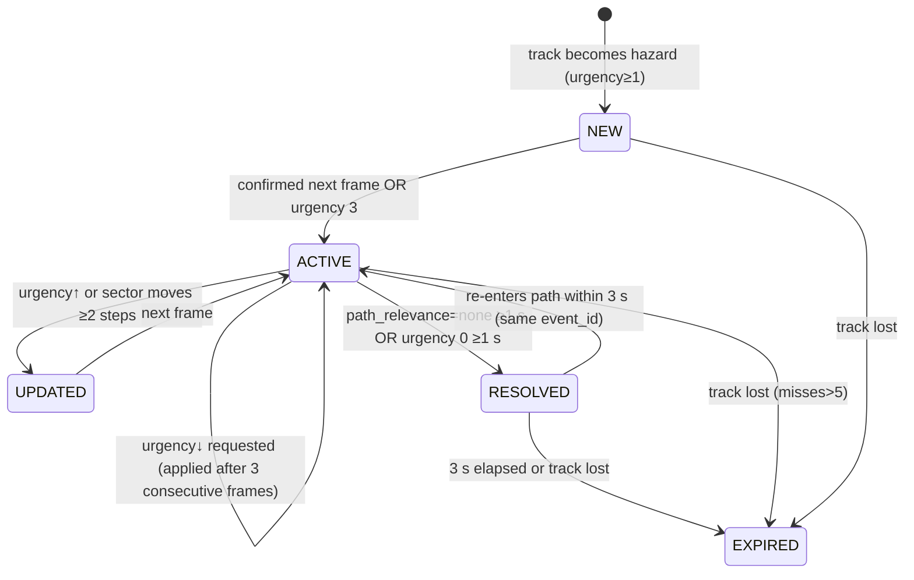

<!-- Part of the MaxSight V1 Technical Architecture Specification. See 00-overview.md. Source: approved plan 2026-10-31. -->

# D3: Stage A Technical Specification

**Scope:**
- Components C-02…C-08.
- Reference implementation in Python (`ml/runtime/stage_a/`) and the production implementation in Swift (`MaxSightCore` + `MaxSightPlatform`), kept identical by golden vectors (DR-114).
- Frame budget at 15 fps is 66.7 ms (DR-101).

### D3.1 Component specifications

| | C-02 FrameQuality | C-03 Detector | C-04 Tracker | C-05 SpatialEstimator | C-06 UncertaintyAssessor | C-07 HazardAssessor | C-08 LocalSafetyController |
|---|---|---|---|---|---|---|---|
| **Purpose** | Decide if a frame supports perception | Find objects of the taxonomy | Persist object identity over time | Direction, ground-plane distance, relative motion | Per-source uncertainty + evidence reliability | Category, path relevance, urgency, hazard events | Alert decisions, dedup, escalation, degraded and system state |
| **Input** | `FrameMetadata` + pixels | pixels, `FrameMetadata`, `FrameQualityResult` | `DetectionBatch`, previous tracks | `TrackedObject[]`, `CameraModel`, quality | detections, tracks, spatial, quality | tracks, spatial, uncertainty, quality, prior events | `HazardAssessment[]`, `HazardEvent[]`, quality, model/camera status |
| **Output** | `FrameQualityResult` | `DetectionBatch` | `TrackedObject[]` | `SpatialEstimate[]` | `UncertaintyAssessment[]` | `HazardAssessment[]`, `HazardEvent[]` | `AlertDecision[]`, `EnvironmentalState` |
| **Algorithm** | 160×90 gray: mean luma, clipped fraction, Laplacian variance, uniformity (obstruction); thresholds in D3.5 | SSDLite-MobileNetV2 @320 (DR-011); Core ML; anchor decode + per-class NMS 0.55; score ≥0.35 *(exp.)* | Greedy IoU ≥0.3 same class; keep through 5 misses; confidence decay 0.8/miss (DR-103) | Pinhole + undistort; azimuth; ground-plane Z=h/tanθ with validity flags; approach rate from box-height slope; TTC; ego-motion from background flow homography (camera-only) | detector: 1−calibrated score; localisation: 1−mean consecutive IoU; tracking: misses/(hits+misses); spatial: σ/d; evidence reliability = rule (D3.6) | Rules R1–R7 (D3.4) over category × path × TTC/distance; escalation immediate, de-escalation after 3 frames | Dedup per hazard (4 s), urgency-increase re-alert, degraded announcements once per episode, fast path to output |
| **State** | none | none | track table (≤64) | camera model; prev. homography | temperature T | per-track previous assessment | event table, last announcements |
| **Frequency** | every processed frame | every processed frame | every processed frame | every frame | every frame | every frame | every frame + timers |
| **Latency budget p95** | 2 ms | 50 ms *(exp.; DR-204)* | 2 ms | 2 ms (incl. flow 1 ms on 160×90) | 1 ms | 2 ms | 1 ms |
| **Memory** | <1 MB | model ≈ 9–18 MB (FP16/FP32) + activations ≈ 20 MB | <1 MB | <2 MB | negligible | <1 MB | <1 MB |
| **Errors** | invalid buffer | load/verify failure; inference error | ID overflow | missing calibration | — | rules file missing/invalid | output backend failure |
| **Fallback** | label `invalid` → INSUFFICIENT_EVIDENCE | REFUSED → `UNAVAILABLE` + announce | reset table, count as discontinuity | distance null + reason; direction from normalised x | spatial uncertainty null | load fails → `UNAVAILABLE` | alternate channel; `DEGRADED` |
| **Unit tests** | T-Q-01…05 | T-D-01…04 | T-T-01…04 | T-S-01…10 | T-U-01…03 | T-H-01…10 | T-C-01…08 |
| **Integration tests** | pipeline replay | parity Py↔Core ML (GV) | pipeline replay | pipeline replay | pipeline replay | rule-trace audit | invariants INV-1…6 |
| **Acceptance** | SG-01 metrics reported; all T-Q pass | export parity Δbox ≤1e-3 rel.; T-D pass | IDF1 reported; T-T pass | MAE by bucket + valid-rate reported; T-S pass | ECE reported | SG-05 metrics reported; 0 untraceable decisions | INV tests pass; SG-06/07 metrics reported |

### D3.1b End-to-end latency budget (replaces summing component p95s)

Per-component p95 values **do not add up** to an end-to-end p95. The budget below is a *design allocation*; compliance is judged only by end-to-end measurements on real iPhones (DR-206), and every boundary is measured separately.

| Boundary | From → to | Allocation (engineering-start) | Measured how |
|---|---|---|---|
| L0 capture-to-processing | sensor PTS → PerceptionActor dequeue (queue wait incl. dropped-frame policy) | ≤ 1 capture interval (33 ms at 30 fps capture), mean ~17 ms | PTS vs `mach_continuous_time` at dequeue |
| L1 preprocessing | pixel buffer → model input (orientation, resize/crop via Core ML image input or vImage) | ≤ 3 ms | signposts |
| L2 model inference | `MLModel.prediction` start → end | measured (no budget pass/fail until DR-204) | signposts |
| L3 postprocessing | raw tensors → `DetectionBatch` (anchor decode, NMS) | ≤ 3 ms | signposts |
| L4 tracking + spatial + uncertainty + hazard (C-02, C-04…C-07) | `DetectionBatch` → `HazardAssessment[]` | ≤ 6 ms | signposts |
| L5 Stage A total | dequeue → `EnvironmentalState` (L1+L2+L3+L4 + scheduling) | ≤ 66.7 ms p95 at PR-001 = 15 fps, or reduce rate | signposts, 10-min and 30-min runs |
| L6 alert decision + dispatch | `EnvironmentalState` → first output API call (haptic `start` / `speak`) | ≤ 5 ms | signposts |
| L7 camera-to-alert | sensor PTS → first output API call (= L0 + L5 + L6) | reported p50/p95/p99; **this** is the user-facing latency (SG-07) | end-to-end harness |
| L7a alert perceptibility | first output call → audible/tactile onset | measured with an external microphone/accelerometer rig once per device model | lab measurement |

If L5 p95 exceeds the frame interval, the controller lowers the processing rate (PR-001/002) and reports `DEGRADED`. **It never queues frames**, because queued frames would raise L0.

### D3.2 Pipeline orchestration

```python
# ml/runtime/stage_a/pipeline.py (reference) — Swift mirrors this in MaxSightCore
class StageAPipeline:                                   # implements StageARunner (existing protocol [E] types.py:42-48)
    def infer(self, frame: CameraFrame) -> EnvironmentalState:
        q = self.quality.assess(frame)                   # C-02
        dets = self.detector.detect(frame) if q.usable else DetectionBatch.empty(frame.meta, reason="quality")   # C-03
        tracks = self.tracker.update(dets)               # C-04
        spatial = self.spatial.estimate(tracks, q)       # C-05
        unc = self.uncertainty.assess(dets, tracks, spatial, q)   # C-06
        hazards, events = self.assessor.assess(tracks, spatial, unc, q)   # C-07
        return self.controller.update(hazards, events, q, self.status)    # C-08 → EnvironmentalState (contains AlertDecisions)
```

`StageARunner.infer` returns `EnvironmentalState` v2 (supersedes the v1 `HazardResult`). An adapter keeps `[E] ml/runtime/contracts.py:51 CriticalEvent` tests passing.

### D3.3 Data contracts (JSON Schema source: `docs/contracts/schemas/stage_a/*.v2.json`; codegen → Python dataclasses, Swift Codable, Kotlin data classes)

**Common rules:**
- `schema_version = "maxsight.stage_a/2.0"`. A breaking change bumps the major version; a reader rejects an unknown major version.
- **Time:** `t_mono_ns` is the monotonic capture clock, in ns since app start (`CMSampleBuffer` PTS mapped to `mach_continuous_time`). `t_wall` (ISO-8601 UTC) is only for logs.
- **IDs:**
  - `frame_id` (uint64, strictly increasing per session)
  - `det_id` = `{frame_id}:{index}`
  - `track_id` (uint32 per session)
  - `hazard_id` = `h{track_id}`
  - `event_id` (UUIDv4)
  - `decision_id` (UUIDv4)
- **Confidence** ∈ [0,1] is the calibrated probability where stated ("calibrated: true"); otherwise it is a raw model score.
- **Unknown** = `null` + an entry in `unknown_reasons[]`. Numeric fields are **never** defaulted to 0 (DR-021).

**FrameMetadata**

| Field | Type | Req | Units | Range | Notes |
|---|---|---|---|---|---|
| frame_id | uint64 | yes | — | ≥1 | strictly increasing |
| t_mono_ns | int64 | yes | ns | ≥0 | capture time |
| width, height | int | yes | px | >0 | source resolution |
| orientation | enum | yes | — | portrait/landscapeLeft/… | from device |
| camera_id | string | yes | — | — | matches calibration file |
| exposure_ms, iso | float \| null | no | ms, — | ≥0 | null if unavailable |

**FrameQualityResult**

| Field | Type | Req | Units | Range | Notes |
|---|---|---|---|---|---|
| frame_id | uint64 | yes | — | — | |
| label | enum | yes | — | ok, dark, overexposed, blur, obstructed, excess_motion, invalid | first match in priority order |
| usable | bool | yes | — | — | false for obstructed/invalid |
| luma_mean | float | yes | 0–255 | — | |
| clipped_frac | float | yes | ratio | 0–1 | |
| laplacian_var | float | yes | — | ≥0 | |
| flow_median_px | float \| null | no | px/frame | ≥0 | null on first frame |

**Detection / DetectionBatch**

| Field | Type | Req | Units | Range | Notes |
|---|---|---|---|---|---|
| det_id | string | yes | — | — | |
| class_name | enum (taxonomy, DR-202) | yes | — | — | |
| score | float | yes | — | 0–1 | raw (calibrated: false) |
| bbox_xyxy | float[4] | yes | px (source) | within frame | |
| — batch: frame_id, model_version, inference_ms | — | yes | ms | — | `detections[]` may be empty; `skipped_reason` set if detection was not run |

**TrackedObject**

| Field | Type | Req | Units | Range | Notes |
|---|---|---|---|---|---|
| track_id | uint32 | yes | — | — | |
| class_name | enum | yes | — | — | majority vote over last 5 |
| bbox_xyxy | float[4] | yes | px | — | latest (predicted if missed) |
| hits, misses, age_frames | int | yes | frames | ≥0 | |
| track_confidence | float | yes | — | 0–1 | decays 0.8/miss |
| last_det_id | string \| null | no | — | — | null when missed this frame |

**SpatialEstimate**

| Field | Type | Req | Units | Range | Notes |
|---|---|---|---|---|---|
| track_id | uint32 | yes | — | — | |
| azimuth_deg | float | yes | deg | −90…90 | + right; image-derived, always available |
| sector | enum | yes | — | left, center_left, center, center_right, right | |
| ground_x_m, ground_z_m | float \| null | no | m | z 0.3–8 | ground-plane only when valid |
| distance_m | float \| null | no | m | 0.3–8 | `hypot(x, z)` |
| distance_sigma_m | float \| null | no | m | ≥0 | propagated from pitch and box error |
| distance_method | enum | yes | — | ground_plane, mono_depth, none | |
| approach_rate_per_s | float \| null | no | 1/s | — | box-height slope / height (≥3 hits) |
| ttc_s | float \| null | no | s | >0 | 1/approach_rate if > 0.05 |
| ego_compensated | bool | yes | — | — | homography applied |
| unknown_reasons | string[] | yes | — | — | e.g. `no_calibration`, `not_floor_contact`, `bottom_truncated`, `above_horizon`, `out_of_range`, `quality`, `occluded`, `few_hits` |

**UncertaintyAssessment**

| Field | Type | Req | Units | Range | Notes |
|---|---|---|---|---|---|
| track_id | uint32 | yes | — | — | |
| detector | float | yes | — | 0–1 | 1 − temperature-scaled score |
| localization | float \| null | no | — | 0–1 | null if < 2 matches |
| tracking | float | yes | — | 0–1 | misses/(hits+misses) |
| spatial | float \| null | no | — | ≥0 | σ/d; null if no distance |
| evidence | enum | yes | — | sufficient, partial, insufficient | rule in D3.6 |
| calibrated | bool | yes | — | — | true once T is fitted (D7.6) |

**HazardAssessment**

| Field | Type | Req | Units | Range | Notes |
|---|---|---|---|---|---|
| hazard_id | string | yes | — | — | `h{track_id}` |
| track_id | uint32 | yes | — | — | |
| category | enum | yes | — | dynamic, static, environmental, context_dependent | DR-018 |
| path_relevance | enum | yes | — | confirmed, possible, none | D3.4 |
| severity | enum | yes | — | low, moderate, high | per class (taxonomy YAML) |
| urgency | int | yes | — | 0–3 | DR-019 |
| qualified | bool | yes | — | — | wording "possible …" |
| rule_ids | string[] | yes | — | ≥1 | traceability |
| uncertainty_ref | track_id | yes | — | — | |

**HazardEvent**

| Field | Type | Req | Units | Range | Notes |
|---|---|---|---|---|---|
| event_id | uuid | yes | — | — | stable for the hazard's life |
| hazard_id | string | yes | — | — | |
| state | enum | yes | — | NEW, ACTIVE, UPDATED, RESOLVED, EXPIRED | DR-029 |
| urgency_max | int | yes | — | 0–3 | |
| first_seen_ns, last_update_ns | int64 | yes | ns | — | |
| delivery | enum | yes | — | PENDING, DELIVERED, DISMISSED, SUPPRESSED_DUP | separate from state |

**AlertDecision**

| Field | Type | Req | Units | Range | Notes |
|---|---|---|---|---|---|
| decision_id | uuid | yes | — | — | |
| event_id | uuid \| null | no | — | — | null for status announcements |
| kind | enum | yes | — | hazard_alert, status_announcement | |
| urgency | int | yes | — | 0–3 | |
| interrupt | bool | yes | — | — | true for 3 |
| message_key | string | yes | — | — | vocabulary key (D5.6) |
| params | object | yes | — | — | {object, direction, distance_m?} |
| frame_id | uint64 | yes | — | — | source frame |
| expires_ns | int64 | yes | ns | — | stale after (frame time + 300 ms) |

**EnvironmentalState**

| Field | Type | Req | Units | Range | Notes |
|---|---|---|---|---|---|
| schema_version, frame_id, t_mono_ns, model_version | — | yes | — | — | Q37 mandatory |
| system_status | enum | yes | — | READY, DEGRADED, OFFLINE, UNAVAILABLE | DR-031 (OFFLINE from C-15) |
| perception_state | enum | yes | — | CLEAR_VALID, POTENTIAL_HAZARD_UNCERTAIN, INSUFFICIENT_EVIDENCE, PERCEPTION_UNAVAILABLE | DR-020 |
| processing_latency_ms | float | yes | ms | ≥0 | frame→state |
| quality | FrameQualityResult | yes | — | — | |
| tracks, spatial, uncertainty, hazards, events, decisions | arrays | yes | — | may be empty | an empty hazards list is meaningful **only** with CLEAR_VALID |
| platform | enum | yes | — | ios, android, reference | evidence tagging |

### D3.4 Hazard assessment logic

**Category assignment** (`configs/hazard/taxonomy.yaml`):
- **dynamic:** class ∈ {person, bicycle, motorcycle, vehicle, animal} and an ego-compensated approach or lateral speed above threshold (approach_rate > 0.15/s or centre drift > 0.1 frame-width/s) *(exp.)*
- **environmental:** class ∈ {stairs, curb, drop_off}
- **static:** class ∈ obstacle set (chair, table, bench, couch, potted_plant, bag_box, trash_bin, pole_bollard, fire_hydrant, traffic_cone, a stationary person or bicycle) with path_relevance ≠ none
- **context_dependent:** anything else (including doors, and obstacle-set classes outside the path)

**Path relevance (Q28–29).** The corridor polygon is the projection of the ground strip ±0.45 m × 0.3–4.0 m (DR-105). Without calibration, a fixed normalised trapezoid is used and `confirmed` is impossible.

| Relevance | Conditions |
|---|---|
| `confirmed` | box bottom-centre inside the corridor **and** hits ≥ 3 **and** distance_m not null |
| `possible` | inside the corridor without the full evidence, or ≥ 30% of the bottom edge inside |
| `none` | otherwise |

**Urgency rules.** These are *(exp.)*, evaluated in order, and the first match wins:

| Rule | Category | Path | Condition | Urgency | Qualified |
|---|---|---|---|---|---|
| R1 | dynamic | ≠none | looming τ < PR-010a (2 s) **and corroborated** (D3.6.3: ≥3 hits, ego_compensated=true, evidence=sufficient, and either valid distance < 2 m or box bottom in lowest 25%) | 3 | if path=possible |
| R1b | dynamic | ≠none | looming τ < 2 s **not corroborated** | 2 | yes |
| R2 | static/environmental | confirmed | distance < 1.0 m | 3 | no |
| R3 | dynamic | ≠none | 2 s ≤ τ < 4 s (corroborated or not) | 2 | if not corroborated or path=possible |
| R4 | static/environmental | confirmed | 1.0–2.0 m | 2 | no |
| R5 | static/environmental/dynamic | possible | box bottom in lowest 25% of frame | 2 | yes |
| R6 | any non-context | ≠none | otherwise (2–4 m or distance unknown) | 1 | if distance unknown |
| R7 | context_dependent | any | — | 0 | — |

Uncertainty never *lowers* urgency. `evidence=insufficient` sets qualified=true. The perception state becomes POTENTIAL_HAZARD_UNCERTAIN when any hazard is qualified.

**Hazard state machine (C-07/C-08):**



**Scenario handling (directive §4):**

| Scenario | Behaviour |
|---|---|
| Detection disappears for one frame | The track persists (miss 1/5) with a predicted box; the hazard stays ACTIVE; no new alert |
| Track temporarily lost (≤5 frames) | Same `track_id` on re-match; a re-match after expiry creates a new track and a new event, but an alert is suppressed if the same class + sector + distance bucket was alerted < 4 s ago (anti-flicker) |
| New detection conflicts with an existing track (class differs) | Class = majority over 5; a conflict sets localisation uncertainty high → qualified |
| Distance becomes unreliable | `distance_m=null`; R2/R4 no longer match → R5/R6 apply (qualified); the event is not resolved |
| Camera quality deteriorates | `DEGRADED`; existing tracks are kept ≤1 s with confidence decay; new hazards qualified; INSUFFICIENT_EVIDENCE after 1 s obstructed |
| Hazard while another alert is active | Higher urgency interrupts (urgency 3) or queues next (2); equal urgency queues FIFO |
| Stage B returns conflicting info | Ignored for safety; delivered only as `inform` after alerts (INV-2) |
| Cloud unavailable | No effect on C-02…C-08 (INV-1) |

### D3.5 Frame-quality thresholds *(exp.; calibrated on 500 labelled frames, SG-01)*

| Label | Rule |
|---|---|
| dark | luma_mean < 40 |
| overexposed | clipped_frac > 0.20 |
| blur | laplacian_var < 60 |
| obstructed | uniformity > 0.60 and laplacian_var < 15 |
| excess_motion | flow_median_px > 25 |

Priority order: invalid > obstructed > overexposed/dark > blur > excess_motion > ok.

### D3.6 Spatial estimation detail (directive §3)

| Quantity | Supported by camera-only? | How | When omitted |
|---|---|---|---|
| Image-space position | Yes | bbox | never |
| Relative direction (azimuth/sector) | Yes | intrinsics | never (normalised fallback without calibration) |
| Relative position on the ground (x, z) | Conditionally | ground plane | any validity flag fails |
| Distance | Conditionally | ground plane (baseline) / mono-depth (Experiment) | as above; spoken only if the bucket passed SG-04 |
| Relative movement (approach) | Yes (scale-based) | box-height slope after ego-compensation | <3 hits |
| Trajectory (future path) | **No in V1** | — | always null |

**Ground-plane model:** θ = pitch + atan((v − c_y)/f_y); Z = h/tan θ; X = Z(u − c_x)/f_x; σ_Z ≈ (Z²/h)·σ_θ.
- h and pitch come from the camera calibration (D3.6.1). Their validity is monitored from the image alone (D3.6.2). No IMU is used (DR-017).
- **Assumptions:** level floor; object touches the ground; box bottom = contact line; known stable pitch.
- **Expected error grows with Z²**, which is why metre values are spoken only for validated buckets.
- **Evidence reliability:**

  | Value | Condition |
  |---|---|
  | `sufficient` | detector ≤ 0.3 and tracking ≤ 0.2 and quality ok |
  | `insufficient` | detector > 0.6, or tracking > 0.5, or quality ∉ {ok} |
  | `partial` | otherwise |

- **Comparison experiment (D7.8):** ground plane vs Depth-Anything-V2-Small (vendored weights, on-device Core ML; camera-only). Same tape-marked clips; MAE, median AE, bias, valid-rate and compute cost reported **per object category × distance bucket × environment × lighting**.

**D3.6.1 Camera calibration and its validity conditions**

| Item | Definition |
|---|---|
| Intrinsics (f, c, distortion) | Per device model and lens, from `run.py calibrate` (checkerboard, RMS ≤ 1 px). Valid for that lens at fixed zoom; the app locks the 1× wide lens and disables digital zoom |
| Extrinsics (h, pitch) | Per user mount, from a 30 s **on-device calibration routine**: the user stands still on level ground; the app detects the floor/wall boundary and two tape marks the user places at 1 m and 2 m (guided by speech), then solves h and pitch. Stored in the FVP-independent `camera_calibration.json` |
| Validity assumptions | camera mounted (not hand-held); level walking surface; object touches the ground; pitch within ±PR-019a of calibration |
| Re-calibration triggers | the app is installed on a new device, the user changes the mount, or the validity monitor flags drift on more than 30% of frames over 5 min (speech prompt "Please re-run calibration") |

**D3.6.2 Calibration-validity monitor (camera-only)**

- **Each frame:** estimate the inter-frame homography from background features (Shi-Tomasi features outside detection boxes → pyramidal LK flow → RANSAC homography, 160×90 grayscale).
- **Rotation estimate** = rotation component of the homography (`H = K R K⁻¹` approximation when translation is small relative to scene depth).
- **Ground-plane validity:** spatial estimates are marked invalid (`distance_m=null`, reason `camera_motion`) when any of these holds:
  - integrated pitch deviation from calibration > 5° over the last 0.5 s (PR-019a)
  - rotation rate > 30°/s (PR-019b)
  - flow is unreliable (below)
- **Optical-flow failure modes and detection:**
  - low texture or dark scenes: < 50 features
  - large moving foreground (crowds): inlier ratio < 0.5 after excluding detection boxes
  - motion blur: frame quality `blur`
  - rolling-shutter skew during fast pans: rotation-rate gate
  - repetitive texture: RANSAC degeneracy, condition number check

  Any failure sets `ego_compensated=false` → downstream approach indicators are flagged unreliable.

**D3.6.3 Image-space approach indicator vs physical velocity**

- **Looming indicator** (image-space, always computable after 3 hits): τ_img = s / (ds/dt), with s the box height after ego-compensation.
  - It is an *indicator*, not a physical TTC.
  - It is unreliable for objects moving laterally, partially occluded boxes, or when `ego_compensated=false`.
- **Physical closing speed** (m/s): computed **only** when `distance_m` is valid on ≥ 3 consecutive frames; v = −Δd/Δt, with σ propagated. Otherwise null.
- **Corroboration rule:** a looming τ can trigger **urgency 3 only when corroborated** (R1). On its own it caps at urgency 2, qualified (R1b), so an unreliable τ cannot independently raise a critical alert.

**D3.6.4 Evidence reliability** is defined in D3.6 above, with PR-018 cut-offs.

### D3.7 Safety invariants (enforced by tests)

| ID | Invariant | Test |
|---|---|---|
| INV-1 | Cloud/Stage B state cannot delay or alter any Stage A output | Run the pipeline with C-14 hung (10 s) → identical `EnvironmentalState` stream and alert timings ±5 ms |
| INV-2 | A stale or conflicting Stage B result cannot override newer local observations | Inject "path clear" during an active urgency-3 → alert delivered; Stage B text after it |
| INV-3 | FVP cannot suppress or alter safety-critical alerts | Property test: 1,000 random FVPs → identical hazards and urgency ≥2 decisions |
| INV-4 | Uncertainty is never presented as certainty | Every qualified hazard renders the "possible …" template; no metres when distance is null or the bucket is unvalidated |
| INV-5 | No detections ≠ safe | CLEAR_VALID only when quality=ok and the model is ACTIVE/LKG; otherwise another state |
| INV-6 | Degraded perception is communicated | Each transition to DEGRADED/UNAVAILABLE/INSUFFICIENT_EVIDENCE yields exactly one announcement per episode |
| INV-7 | Stage A imports no network, profile or Stage B module | Transitive import test (subprocess `sys.modules` ban list) |
| INV-8 | Production perception is condition-independent | The detector graph has no condition input; condition fields are absent from the Stage A schemas |
