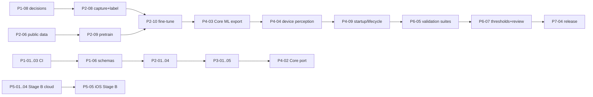

<!-- Part of the MaxSight V1 Technical Architecture Specification. See 00-overview.md. Source: approved plan 2026-10-31. -->

# D9: Implementation Roadmap

Every task starts as `Not started`. `Partial` means some existing code is reused. Each task is one PR into `dev` and needs CI green; safety paths need the `safety-review` label.

### D9.0 Phase exit criteria and contingency paths

**Phases advance only on evidence, never on calendar.**

| Phase | Exit criteria (all required) | Contingency if not met |
|---|---|---|
| 1 Contracts | CI green on `main`; D1–D10 + ADRs merged; schemas + golden harness in CI; DR-201/202/206 decided (DR-204 may remain open) | If decisions slip, Phase 2 continues only on taxonomy-independent work (P2-01…07); capture (P2-08) waits for DR-202 |
| 2 Stage A foundation | Dataset audit passed; M-SSD fine-tuned; eval report with CIs; T-Q/T-D/T-T green | Below the COCO-only baseline → label QA, then more data for weak classes; if pretraining cost/time is excessive → start from COCO-pretrained SSDLite-MBv3 as an interim and record the deviation in an ADR |
| 3 Spatial and safety | T-S/T-U/T-H/T-C + INV-4…8 green; spatial experiment report (valid-rate and error by category × bucket × environment); rule-trace 100% | If ground-plane valid-rate on walking clips < 30% *(eng.)* → distances are not spoken in V1 (zones and direction only), recorded via ADR |
| 4 iOS integration | Golden parity 100%; Core ML export parity; L5/L7 measured on the reference iPhone; startup/lifecycle tests pass | Export incompatibility → move ops to Swift or change the export path; L5 over budget → lower PR-001, INT8, or the next candidate (D7.0 device gate) |
| 5 Stage B | Committed capabilities of D4.0 pass D4.5 evaluations; T-B suite + INV-1/2 green; budget alarms live | A task failing quality → removed from the Committed list (matrix + store copy updated) rather than shipped weak |
| 6 Validation | All SG cells computed; thresholds approved; formative study done | No candidate passes the hard filter → iterate data/model (back to Phase 2 gates); reviewers unavailable → release blocked (no self-approval) |
| 7 Release | D8.6 checklist complete; `gate_release` passes | — |

**Schedule (D9.9)** is a planning estimate only. Re-plan after each phase exit using the measured effort.

### D9.1 Phase 1: Architecture contracts and repo health

| ID | Workstream | Deliverable | Deps | Steps | Acceptance | Tests | Evidence | Status | Risk |
|---|---|---|---|---|---|---|---|---|---|
| P1-01 | Repo | Lazy package inits | — | PEP 562 `__getattr__` in `app/__init__.py:3`, `ml/data/__init__.py:3`, `ml/pipeline/__init__.py:3` | phone-app-layer, drift-checks, sagemaker-ops, pre-SM ontology pass | existing suites | CI run link | Not started | hidden import cycles |
| P1-02 | Repo | Test fixes | — | fix imports `tests/test_phase0_backbone.py:141-182`; `@pytest.mark.benchmark` on latency asserts; skip `test_condition_specific.py:206` without a checkpoint | unit-tests-cpu green | — | CI | Not started | — |
| P1-03 | Repo | IAM stubs + pyright config | — | add 3 files required by `ml/infra/security_policy.py:27-30`; remove `venvPath`/`venv`/`extraPaths` (`pyrightconfig.json:18,31-32`, `pyproject.toml:15,24-25`) | Quality workflow green | — | CI | Not started | — |
| P1-04 | Governance | Branches, CODEOWNERS, `safety-review` label, branch protection | — | create `dev`; protection rules | rules active | — | settings screenshot | Not started | — |
| P1-05 | Governance | `docs/architecture/v1/` D1–D10 + ADR-001…016 | — | commit this document split into 10 files + ADRs | files merged; your approvals recorded on Proposed rows | — | PR | Not started | scope creep |
| P1-06 | Contracts | JSON Schemas (11 Stage A, Stage B, FVP) + codegen | P1-05 | write schemas; `scripts/infra/gen_schemas.py` → Python dataclasses; Swift via quicktype; schema tests | round-trip tests pass | T-schema | CI | Not started | codegen drift |
| P1-07 | Contracts | Golden-vector harness | P1-06 | `scripts/infra/export_golden_vectors.py`; vector format | 10 synthetic vectors generated | T-GV | artifacts | Not started | — |
| P1-08 | Decisions | Resolve DR-201 (egress), DR-202 (taxonomy), DR-204 (latency boundary), DR-206 (device matrix) | — | decision meetings with you; ADRs | ADRs Confirmed | — | ADR files | Not started | **critical path** |

### D9.2 Phase 2: Stage A foundation (reference implementation + data)

| ID | WS | Deliverable | Deps | Steps | Acceptance | Tests | Evidence | Status | Risk |
|---|---|---|---|---|---|---|---|---|---|
| P2-01 | Stage A | C-02 FrameQuality (Py) | P1-06 | implement D3.5 | T-Q pass | T-Q | CI | Not started | thresholds need labels |
| P2-02 | Stage A | C-03 Detector wrapper + `build_ssdlite_mbv2` (Py) | P1-06 | D7.1 M-SSD; strict load | T-D-01…03 | T-D | CI | Not started | anchor config errors |
| P2-03 | Stage A | C-04 IoU tracker (Py) | P1-06 | D3.1 | T-T pass | T-T | CI | Not started | — |
| P2-04 | Stage A | Model handle hardening | P2-02 | require `.sig` (`model_handle.py:46-54`); decode calibration PNG (`:86-91`); replace `torch_runner.py:57-65` swallow | T-M pass | T-M | CI | Partial | — |
| P2-05 | Data | Dataset retirement + registry | P1-01 | move synthetic to `synthetic_legacy/`; registry entries | gate shows legacy excluded | — | PR | Not started | — |
| P2-06 | Data | Public data harmonisation | P2-05 | `coco_subset`, OI download, `vistas_import`, `harmonize`, `build_pretrain_mix`; licence register | `gate_pretrain` balance pass (no class >15%) | T-label-map | `class_report.md` | Not started | download size, licences |
| P2-07 | Data | Capture rig + calibration tool | — | `run.py calibrate`; chest mount; protocol doc | RMS ≤1 px | — | `camera/*.json` | Not started | — |
| P2-08 | Data | Capture + CVAT labelling of Hazard v1 | P2-07, P1-08 (taxonomy) | D7.4 plan; guide; κ | ≥560 clips; κ ≥0.7; `gate_pretrain` pass | — | dataset hash | Not started | **critical path**, labour |
| P2-09 | ML | Stage 1 pretrain M-SSD | P2-02, P2-06 | SageMaker job | val mAP reported | — | run manifest | Not started | GPU cost/time |
| P2-10 | ML | Stage 2 fine-tune M-SSD | P2-08, P2-09 | D7.6 | checkpoint + manifest | — | run manifest | Not started | overfitting small set |

### D9.3 Phase 3: spatial, uncertainty, hazard, safety, output (reference)

| ID | WS | Deliverable | Deps | Steps | Acceptance | Tests | Evidence | Status | Risk |
|---|---|---|---|---|---|---|---|---|---|
| P3-01 | Stage A | C-05 Spatial (ground plane, flags, approach, ego-flow) | P2-03, P2-07 | D3.6 | T-S pass | T-S | CI | Not started | calibration drift while walking (D3.6.2); low valid-rate → zones only (D9.0) |
| P3-02 | Stage A | C-06 Uncertainty + temperature fit | P2-10 | D3.1; fit T on val | T-U pass; ECE reported | T-U | report | Not started | — |
| P3-03 | Stage A | C-07 Assessor + rules YAML | P3-01, P3-02 | D3.4 | T-H pass; 100% rule trace | T-H | CI | Not started | rule tuning |
| P3-04 | Stage A | C-08 Safety controller + EnvironmentalState | P3-03 | D3.4 state machine | T-C + INV-4/5/6 pass | T-C, INV | CI | Not started | — |
| P3-05 | Eval | `hazard_eval`, `cluster_bootstrap`, `sample_size`, `decision_matrix`; SG cell computation | P3-04 | D7.9, D8.1 | reports generated on the dev set | T-eval | `report.md` | Not started | — |
| P3-06 | Ref app | Python reference live loop + speech (`say`) for the dev demo | P3-04 | `run.py live` | demo clip alerts | T-SYS | video | Not started | — |
| P3-07 | Tooling | Playwright test for the simulator | P3-06 | `tools/simulation` | T-W-01 pass | T-W | CI | Not started | — |

### D9.4 Phase 4: iOS application integration

| ID | WS | Deliverable | Deps | Steps | Acceptance | Tests | Evidence | Status | Risk |
|---|---|---|---|---|---|---|---|---|---|
| P4-01 | iOS | Xcode project + SPM packages skeleton | P1-06 | D6.1 targets; CI build | builds on CI | — | CI | Not started | — |
| P4-02 | iOS | MaxSightCore (Swift port of C-04…C-08, C-11 rules) | P4-01, P3-04 | port + golden vectors | T-GV parity 100% | XCTest | CI | Not started | numeric drift |
| P4-03 | iOS | Core ML export + Swift decode/NMS | P2-10 | D7.7 | Δbox ≤1e-3 rel.; L1 measured | T-D-04 | parity report | Not started | op support |
| P4-04 | iOS | Camera + PerceptionActor + quality + spatial | P4-02, P4-03 | D2.4 | L2 p95 measured on device | perf tests | Instruments trace | Not started | thermal |
| P4-05 | iOS | ModelStore (P256 verify, LKG, staging, rollback) | P4-01, P5-06 | D6.1 | T-M pass on device | XCTest | CI | Not started | key management |
| P4-06 | iOS | OutputManager (AVSpeech, CoreHaptics, audio session) | P4-01 | D5.4 | T-O pass | XCTest + device | recording | Not started | VoiceOver interplay |
| P4-07 | iOS | FVPStore + onboarding + settings + ConsentManager | P4-01 | D5.1, D5.5 | XCUITest flows; VoiceOver labels | XCUITest | screen recording | Not started | — |
| P4-08 | iOS | PolicyEngine wired + status indicator | P4-02, P4-06, P4-07 | D5.3 | T-P pass; INV-3 | XCTest | CI | Not started | — |
| P4-09 | iOS | Startup sequence + lifecycle (background, interruptions) | P4-04…P4-08 | D6.1 startup | T-C status tests on device | XCUITest | log | Not started | — |

### D9.5 Phase 5: Stage B

| ID | WS | Deliverable | Deps | Steps | Acceptance | Tests | Evidence | Status | Risk |
|---|---|---|---|---|---|---|---|---|---|
| P5-01 | Cloud | CDK app: API GW, Lambda, DynamoDB (quota, idempotency, prefs), Cognito, budgets, CloudWatch | P1-08 (DR-208) | D2.5, D4.3 | `cdk deploy` dev OK; budget alarms active | infra tests | stack outputs | Not started | cost |
| P5-02 | Cloud | Orchestrator λ + schema validation + quota + idempotency + kill switch | P5-01 | D4.2–4.3 | T-B-01…03, 08 pass | pytest | CI | Not started | — |
| P5-03 | Cloud | Bedrock integration per task (SB-OCR, SCENE, VQA, FIND synonyms) with grounding prompts | P5-02, DR-213 | D4.1 | D4.5 eval run | eval | report | Not started | hallucination |
| P5-04 | Cloud | Knowledge retrieval over the approved corpus | P5-02 | corpus licence register; index | citation eval | eval | report | Not started | corpus approval |
| P5-05 | iOS | SpeechInput + Router + StageBClient + on-device OCR | P4-08, P5-02 | D6.1 | T-B-04/05/06 pass; INV-1/2 on device | XCTest | recording | Not started | ASR accuracy |
| P5-06 | Release | Signing pipeline: certification → manifest → KMS sign → S3 releases; fix `artifact_signing.py:42-45` random key; ECDSA verify replacing HMAC in `verify.py:20-53` | P3-05 | D2.13 | tamper/rotation tests pass | T-M | CI graph | Partial | key custody |

### D9.6 Phase 6: Validation

| ID | WS | Deliverable | Deps | Steps | Acceptance | Tests | Evidence | Status | Risk |
|---|---|---|---|---|---|---|---|---|---|
| P6-01 | ML | Comparison runs M-R50, M-EDL0, M-SSD-FPN, M-R50-MS | P2-08 | D7.6 | reports | — | runs | Not started | GPU time |
| P6-02 | ML | Precision study FP32/FP16/INT8 on iPhone | P4-03 | D7.7 | DR-116 decision | — | report | Not started | — |
| P6-03 | ML | Spatial experiment (DR-203) | P3-01, P2-08 | D7.8 | report + ADR | — | report | Not started | DR-211 |
| P6-04 | ML | Model selection (DR-041) | P6-01…03 | D7.9 | ADR-007 approved | — | ADR | Not started | no candidate passes |
| P6-05 | QA | Device replay harness + fault suite + ambiguous suite | P4-09 | D8.2 | SG-06/07/08 cells computed | INV, T-* | `sg*.json` | Not started | — |
| P6-06 | QA | Thermal/battery 30-min sessions on the device matrix | P4-09 | D8.2 | report | — | report | Not started | — |
| P6-07 | Safety | Threshold proposal + independent review | P6-04, P6-05 | D8.1 | thresholds approved (DR-205) | — | approval records | **Blocked** (DR-209) | reviewer access |
| P6-08 | HF | Formative usability (5–10 participants) | P6-07, ethics | pilot checklist (Q255) | findings triaged | — | report | **Blocked** (DR-209) | recruitment |

### D9.7 Phase 7: Release preparation

| ID | WS | Deliverable | Deps | Steps | Acceptance | Tests | Evidence | Status | Risk |
|---|---|---|---|---|---|---|---|---|---|
| P7-01 | Docs | Component READMEs (Q279 template), intended use, limitations | all | — | complete | — | PR | Not started | — |
| P7-02 | Security | Security and privacy review (egress, auth, storage, signing) | P5-* | checklist | no open criticals | T-B, T-M | report | Not started | — |
| P7-03 | Ops | Runbooks (rollback, kill switch, budget, incident) | P5-01 | — | dry-run done | — | runbook | Not started | — |
| P7-04 | Release | `gate_release.py` + versioned V1 release | P6-07, P7-01…03 | D8.6 | all SG cells passed; approvals | all | release manifest | Not started | — |
| P7-05 | Pilot | 15–30 participant pilot approval | P6-08, P7-04 | Q256 | approval | — | approval | **Blocked** | — |

### D9.8 Critical path and parallelism

**Parallel tracks:**
- Phase 5 cloud (P5-01…04) after P1-08.
- Public data + pretraining (P2-06/09) alongside capture (P2-08).
- iOS skeleton + Output + FVP (P4-01/06/07) alongside ML work.

**External blockers:** DR-209 (reviewers, ethics) and DR-216 (glasses hardware).

### D9.9 Resources and schedule (one engineer, ~15 h/week; estimates)

**Hardware *(approx. US prices)*:**

| Item | Cost |
|---|---|
| iPhone 13 or newer | $250–500 used |
| Chest mount | $30 |
| Checkerboard | $15 |
| Tape | $15 |
| 2 TB SSD | $120 |
| Apple Developer Program | $99/yr |
| SageMaker g5 (~25 h) | ≈ $35–50 |
| Stage B dev usage | budget alarm at e.g. $50/month (DR-208) |

**Schedule (start 2026-11-02, indicative):**

| Weeks | Phase |
|---|---|
| 1–2 | Phase 1 |
| 2–8 | Phase 2 (capture and labelling dominate: ~18 h capture, ~30 h labelling) |
| 5–9 | Phase 3 |
| 8–14 | Phase 4 |
| 10–16 | Phase 5 |
| 14–20 | Phase 6 technical |
| — | Human-factors steps start when DR-209 is resolved |

## Verification of this plan's execution

- **Phase 1 done:**
  - `gh run list --branch main --limit 2` shows both workflows green.
  - `docs/architecture/v1/01…10` and `docs/adr/001…016` are merged.
  - Schema round-trip and golden-vector tests pass.
  - DR-201/202/204/206 are recorded as Confirmed ADRs.
- **Phase 2–3 done:**
  - `pytest -q` passes, including T-Q/T-D/T-T/T-S/T-U/T-H/T-C and INV-4…8.
  - `python scripts/infra/gate_pretrain.py data/gold/hazard_v1` passes.
  - `run.py eval-stage-a` produces M-SSD reports with cluster-bootstrap CIs and SG cells (`threshold_pending`).
- **Phase 4 done:**
  - XCTest/XCUITest pass on the reference iPhone.
  - The golden-vector parity report shows 100%.
  - The Instruments trace shows L1/L2/L4 p95.
  - Deleting both model signatures → `UNAVAILABLE` + one spoken refusal.
- **Phase 5 done:**
  - The dev `cdk deploy` succeeds.
  - T-B suite passes against the dev API.
  - Stage B requests fail cleanly offline.
  - INV-1/2 pass on device.
- **Phase 6–7:** every SG cell `passed` with approved thresholds; D8.6 checklist complete; release manifest signed.
